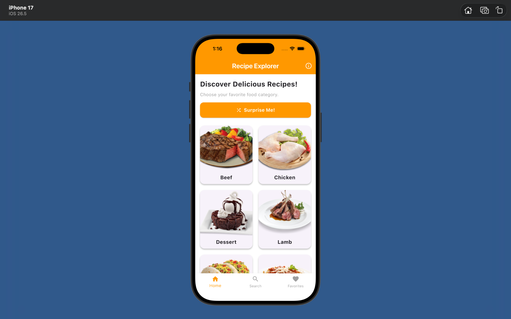
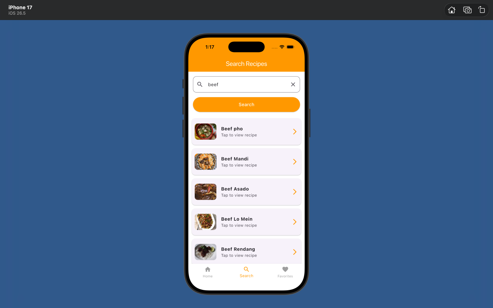
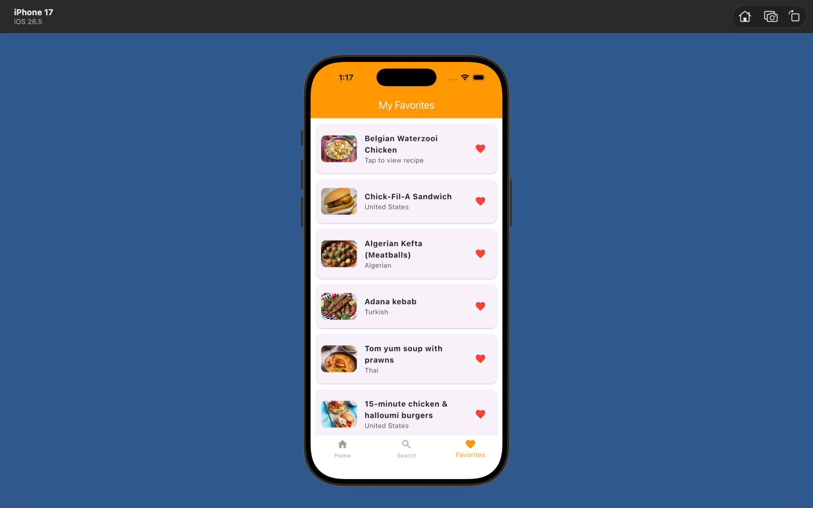

# 🍽️ Recipe Explorer

**A Flutter-Based Recipe Discovery Application**

Recipe Explorer is a mobile application developed using Flutter and Dart. It allows users to explore food categories, discover meals, view detailed cooking instructions, search for recipes, and save their favorite meals.

The application uses TheMealDB API to retrieve real recipe information.

---

## 👨‍💻 Developer Information

| Information | Details |
|---|---|
| Developer Name | MAHMUD MD KAWSAR |
| Student ID | 2024891027 |
| Project Name | Recipe Explorer |
| University | Kyungsung University |
| Course | Mobile Application Development |
| Development Framework | Flutter |
| Programming Language | Dart |

---

## ✨ Application Features

- **Browse Categories:** Explore different food categories with images and descriptions.
- **Meal Discovery:** View meals belonging to each category.
- **Meal Details:** View meal images, names, categories, cooking areas, ingredients, measurements, and instructions.
- **Search Recipes:** Search for meals by name.
- **Favorites:** Add or remove favorite recipes.
- **Persistent Favorites:** Favorite meals remain saved after restarting the application.
- **Random Meal:** Discover a random recipe using the Surprise Me feature.
- **About Screen:** View application and developer information.
- **Bottom Navigation:** Easily navigate between Home, Search, and Favorites.
- **Loading and Error Handling:** Display loading indicators, error messages, retry options, and no-results messages.

---

## 🛠️ Technologies Used

| Technology | Purpose |
|---|---|
| Flutter 3.47.3 | Mobile application framework |
| Dart 3.13.3 | Programming language |
| TheMealDB API | Recipe and meal data |
| HTTP | API communication |
| SharedPreferences | Local favorite storage |
| JSON | API response parsing |
| VS Code | Development environment |

---

## 🌐 API Integration

Recipe Explorer uses the free TheMealDB API.

**API Base URL:**

https://www.themealdb.com/api/json/v1/1

API endpoints used:

- Categories: `/categories.php`
- Meals by category: `/filter.php?c=Seafood`
- Meal details: `/lookup.php?i=52772`
- Search meals: `/search.php?s=chicken`
- Random meal: `/random.php`

API Provider: [TheMealDB](https://www.themealdb.com/)

---

## 📱 Application Screenshots

Add your actual application screenshots to the `screenshots` folder in the project root.

Once added, use these image paths:

### Home Screen


### Search Screen


### Favorites Screen


---

## 📂 Project Structure

```text
lib/
├── main.dart
│
├── models/
│   ├── category.dart
│   └── meal.dart
│
├── services/
│   ├── meal_api.dart
│   └── favorites_storage.dart
│
├── screens/
│   ├── home_screen.dart
│   ├── meal_list_screen.dart
│   ├── meal_detail_screen.dart
│   ├── search_screen.dart
│   ├── favorites_screen.dart
│   └── about_screen.dart
│
└── widgets/
    └── meal_card.dart

assets/
└── images/
    └── profile.jpg
```

---

## 🚀 Installation and Setup

### Prerequisites

- Flutter SDK 3.47.3 or later
- Dart SDK
- Visual Studio Code or Android Studio
- An emulator or physical mobile device
- Internet connection

### 1. Clone the Repository

```bash
git clone https://github.com/mdkawsarmahmud11-coder/mobile-app-final-2024891027.git
```

### 2. Navigate to the Project Folder

```bash
cd mobile-app-final-2024891027
```

### 3. Install Dependencies

```bash
flutter pub get
```

### 4. Run the Application

```bash
flutter run
```

---

## 📦 Dependencies

The main packages used in this project:

- `http` – Fetching recipe information from the API.
- `shared_preferences` – Saving favorite meal IDs locally.

---

## 🎯 Learning Objectives

This project demonstrates practical knowledge of:

- Flutter widgets and UI design.
- StatelessWidget and StatefulWidget.
- State management using `setState()`.
- Navigation between screens.
- Asynchronous programming using `async` and `await`.
- REST API integration using HTTP.
- JSON parsing and model classes.
- Local data persistence using SharedPreferences.
- Error handling and loading states.

---

## 🎨 Application Design

- Primary Color: Orange
- Background Color: White
- Design Style: Simple, clean, and user-friendly.
- Platform: Mobile Application

---

## 🙏 Acknowledgements

Special thanks to **TheMealDB** for providing the recipe API and meal information used in this application.

---

## 📄 License

This project was developed for academic purposes as a university final project.

**Developed by MAHMUD MD KAWSAR**

Kyungsung University | 2026
